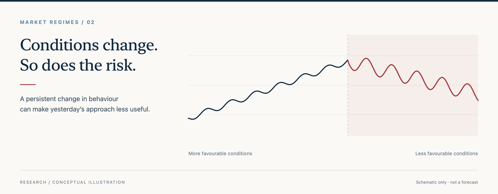
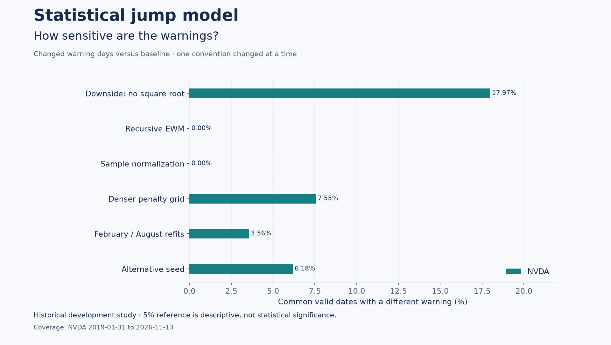
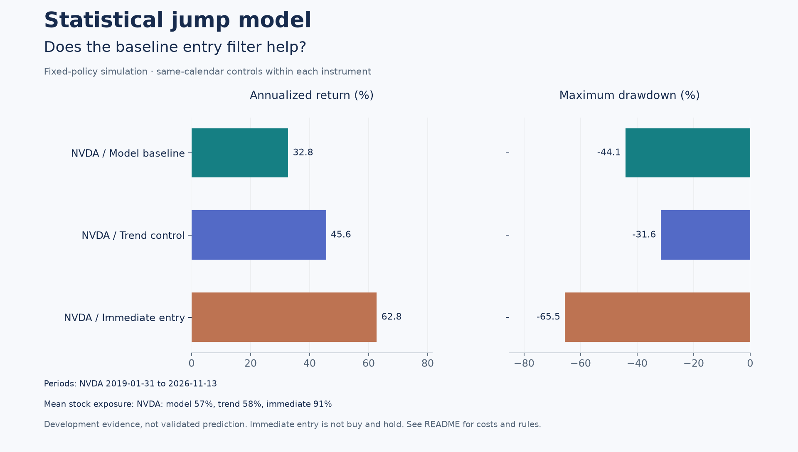

# Statistical jump model

*Has the market shifted into a less favourable pattern?*

*Could a change in market conditions mean taking more risk for less reward?*



Standalone Python research implementation with independent numerical fixtures
and explicit replication questions for the paper authors.

**Replication work in progress.** Not author-endorsed, not a reproduction of
the original empirical results, and not a validated trading or forecasting system.
Unspecified settings remain declared conventions.

## Run locally

Python 3.12 and [uv](https://docs.astral.sh/uv/) are used for the checked setup.

```sh
git clone https://github.com/schmittsfn/statistical-jump-model.git
cd statistical-jump-model
uv sync --locked
uv run --no-sync python -m unittest discover -s tests -v
uv run --no-sync python examples/synthetic.py
```

The example fits one 3,000-observation calibration. The full monthly-selected policy is available as `jump_policy`; it requires much longer history.
Inputs are generated locally; no download or credential is needed.

## Source and implementation

Implementation: [`src/statistical_jump_model/__init__.py`](src/statistical_jump_model/__init__.py). Tests:
[`test_jump.py`](tests/test_jump.py).

Source: Shu, Yu and Mulvey, *Downside Risk Reduction Using Regime-Switching
Signals*, [arXiv:2402.05272v3](https://arxiv.org/abs/2402.05272v3), sections
3.4.1–3.4.3. The [`jumpmodels`](https://github.com/Yizhan-Oliver-Shu/jump-models)
author library performs fitting and supplies the reference dynamic program.

`jump_policy(asset_returns, cash_returns)` uses aligned daily simple returns,
not prices or annual yields. The caller must supply complete, correctly dated
sessions and cash returns. Missing cash is not replaced with zero.

The implementation uses excess-return DD10/Sortino20/Sortino60 features,
3,000-observation training and rolling inference, semiannual calibration,
monthly penalty selection over eight calendar years of online strategy returns,
and 10bp per exposure change. Signal t affects return t+2. It requires a long
history before producing its first selected strategy state.

Declared choices: normalized EWM weights; square-root downside deviation
following author code rather than the printed expression; population feature
standardization; January/July calibration anchors; penalty grid
[0, 1, 3, 10, 30, 100, 300, 1000]; seed 137. Calendar month-end detection uses
XNYS. Other exchanges are not supported by that calendar convention.

State labels follow author cumulative-return sorting, including unreachable
empty states. Original Bloomberg/GFD datasets and experiment configuration are
not included. The author library is a dependency, not vendored or relicensed.

## Example research results

The graphics below summarize a separate convention-sensitivity study completed
on 15 November 2026. They are **historical development results**, not the paper's
results, an untouched holdout test, or a backtest reproduced by this standalone
package. The study's baseline warnings matched its earlier archived baseline.
Alternative-convention execution and the entry evaluator live in the separate
research harness; this repository's API has not been expanded by these figures.



*The warnings depend noticeably on the settings: some choices change the buy-or-wait decision on nearly one day in five. A single version should therefore not be treated as a definitive answer.*

Changing one convention at a time can change a warning without establishing
which convention is correct. Percentages use each alternative's common valid
dates; counts and dates are in [the plotted data](docs/results/summary.json).
The dashed 5% line is a predeclared descriptive marker, not a significance test.



*The simple trend rule earned more and suffered a smaller worst decline than the model, while keeping a similar amount invested. In this test, the model did not improve the trade-off between return and risk.*

Each instrument uses its own period shown in the graphic. Compare policies
within an instrument, not returns across instruments or repositories. Lower
drawdown can reflect spending more time in cash. The model baseline underperformed
the trend control's annualized return on the NVIDIA calendar.

SMH is unavailable: its history is too short for 3,000 training sessions followed by eight years of selection. February/August refits have 1,940 common NVIDIA dates instead of 1,959.

**Entry experiment:** three funded sleeves; opportunities every 21 sessions;
next-open execution; fixed 60-session exit; at most 20 sessions waiting; 10 basis
points per side; historical Treasury cash proxy. “Immediate” uses that same
schedule and is **not buy and hold**. “Trend” uses the combined 50/200-day rule.
No taxes or investor-specific costs. Previously inspected, retrospectively
reconstructed history; no complete point-in-time vintages. No forecast or
trading-validity claim follows.

Figures contain aggregate research outputs only, not market-data captures or
personal portfolio information. Re-render these exact summary graphics with:

```sh
uv run --with matplotlib python examples/render_results.py
```

This renders [summary.json](docs/results/summary.json); it does not rerun or
independently reproduce the underlying historical study. The JSON records the
frozen protocol hash and comparison identity for provenance.

## Replication and contributions

See [open questions](docs/REPLICATION_QUESTIONS.md),
[verification scope](docs/VERIFICATION.md) and [provenance](NOTICE.md).
For a correction, provide the paper version, equation/page, and a minimal
reference input/output or failing test. See [CONTRIBUTING.md](CONTRIBUTING.md).

This repository contains only this model. It does not require the other risk
model repositories or the earlier combined package. No private data, portfolio
records, market captures or paper PDFs are distributed. Callers supply their
own appropriately licensed data. Original-paper empirical results have not
been reproduced here.

Code, tests and documentation were prepared with OpenAI Codex assistance.
MIT license covers this project's files; dependencies and papers retain their
respective licenses and rights. No independent academic audit is claimed.

## Rebuild the introductory illustration

The introductory graphic is drawn locally with SwiftUI and exported with
`ImageRenderer`. It is schematic, not observed market data. No image service,
API key or paid generation is used. On macOS with Xcode command-line tools:

```sh
swiftc -parse-as-library examples/hero/HeroView.swift examples/hero/Export.swift -o /tmp/render-risk-hero
/tmp/render-risk-hero docs/hero/concept.png
```

The export is a 2400 × 940 PNG. Source: [HeroView.swift](examples/hero/HeroView.swift).
